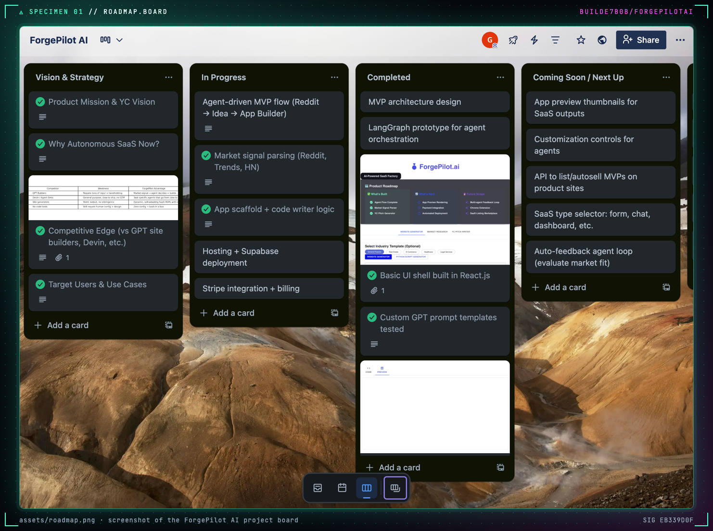
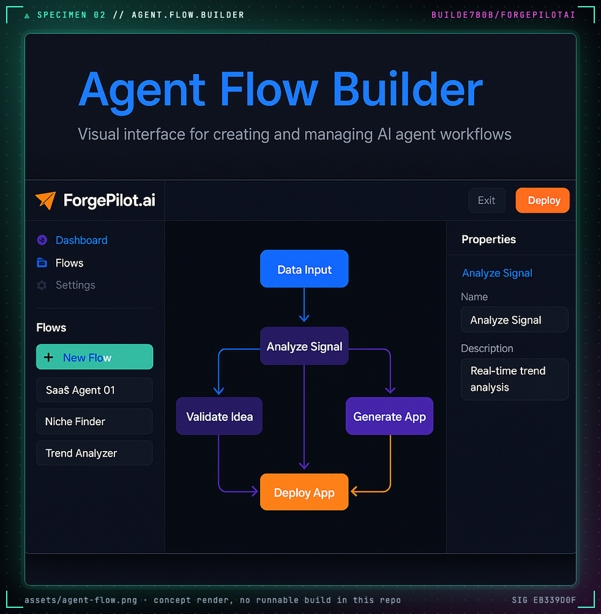
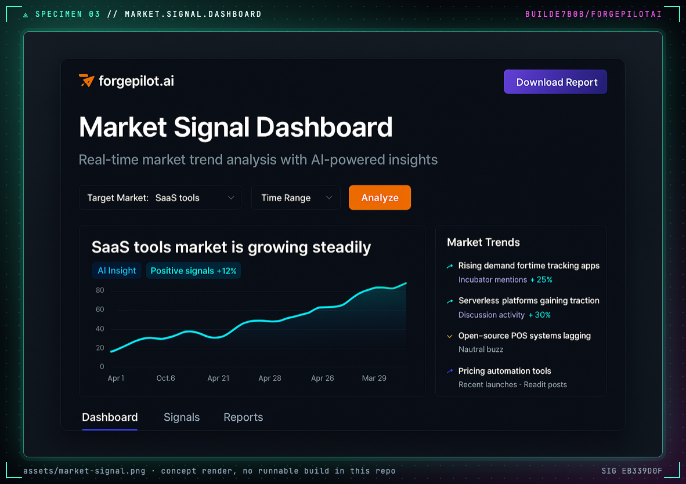

<div align="center">



<a href="#-join-the-alpha"></a>


**Build SaaS like a team of ten.** ForgePilot is an autonomous startup engine: AI agents that carry one founder from idea to distribution.

<p align="center">
<a href="#-the-core-directive">Directive</a> ·
<a href="#-four-capabilities-one-runtime">Capabilities</a> ·
<a href="#-specimens-from-the-build-log">Specimens</a> ·
<a href="#-roadmap-as-of-the-board-snapshot">Roadmap</a> ·
<a href="#-join-the-alpha">Join the alpha</a>
</p>

</div>

> [!NOTE]
> This repository is the project's public face: the mission, the planned stack, a snapshot of the roadmap board and concept renders. **It contains no source code**, so there is nothing to install or run here yet. The images below are labeled as either a board screenshot or a concept render.

##  The core directive

ForgePilot exists to eliminate the solo founder bottleneck: one person launching ten SaaS products, with the pipeline automated end to end.

```bash
forgepilot@core-system:~$ cat mission_statement.txt
> Loading core directive...
> ForgePilot exists to eliminate the solo founder bottleneck.
> We enable ONE person to launch TEN SaaS products.
> Automating: [Ideation] -> [Dev] -> [Hosting] -> [Copywriting] -> [Billing] -> [Distribution]
> Status: SYSTEM ONLINE.

forgepilot@core-system:~$ ./execute_vision.sh
> Analyzing YC Golden Rule: "Make something people want—and scale it fast."
> Tapping into real-time demand signals...
> Deploying production-ready tools autonomously...
> Result: The next YC unicorn might be built by 1 person with 10 agents.
```

<sub>⟁ decoded from the original transmission; a narrative, not a runnable script</sub>

##  Four capabilities, one runtime

| | |
|---|---|
| **🧠 Autonomous reasoning**<br>Agents built on LangGraph and MemGPT that reason across complex, multi-step dev workflows. | **⚡ Instant shipping**<br>Open-source SaaS kits and cloud infra take ideas to production near-instantly. |
| **📡 Market signal injection**<br>Real-time demand signals (Reddit, Twitter, IndieHackers) decide what gets built. | **🧩 Modular runtime**<br>Bring your own components, plug into the ForgePilot runtime and deploy in minutes. |

**The tech engine.** Built on battle-tested, modern tools, optimized for speed, modularity and automation. This is the stated stack; none of it is checked into this repo.

| Layer | Tools |
|---|---|
| AI and agents | LangChain · LangGraph · MemGPT · Anthropic |
| Frontend | React · TypeScript |
| Backend and infrastructure | Supabase · Vercel · OpenAPI |

<p align="center"></p>

##  Specimens from the build log

<table>
  <tr>
    <td colspan="2" align="center">
      
      <br><sub>◬ 01 · The ForgePilot AI project board: vision, work in progress, completed items and what's next.</sub>
    </td>
  </tr>
  <tr>
    <td width="50%" align="center">
      
      <br><sub>◬ 02 · Agent Flow Builder concept: Data Input → Analyze Signal → Validate Idea / Generate App → Deploy App.</sub>
    </td>
    <td width="50%" align="center">
      
      <br><sub>◬ 03 · Market Signal Dashboard concept: pick a target market and time range, get a trend chart and AI insights.</sub>
    </td>
  </tr>
</table>

<sub>⟁ Specimen 01 is a screenshot of the project board. Specimens 02 and 03 are concept renders: their data and labels are illustrative, and no build of these screens ships in this repo. Originals are in <a href="assets/">assets/</a>.</sub>

##  Roadmap, as of the board snapshot

Transcribed from [`assets/roadmap.png`](assets/roadmap.png). ✓ marks a card checked off on the board.

| Vision & strategy | In progress | Completed | Coming soon / next up |
|---|---|---|---|
| ✓ Product mission & YC vision | Agent-driven MVP flow (Reddit → Idea → App Builder) | MVP architecture design | App preview thumbnails for SaaS outputs |
| ✓ Why autonomous SaaS now? | ✓ Market signal parsing (Reddit, Trends, HN) | LangGraph prototype for agent orchestration | Customization controls for agents |
| ✓ Competitive edge (vs GPT site builders, Devin, etc.) | ✓ App scaffold + code writer logic | ✓ Basic UI shell built in React.js | API to list/autosell MVPs on product sites |
| ✓ Target users & use cases | Hosting + Supabase deployment | ✓ Custom GPT prompt templates tested | SaaS type selector: form, chat, dashboard, etc. |
| | Stripe integration + billing | | Auto-feedback agent loop (evaluate market fit) |

<p align="center"></p>

##  Join the alpha

ForgePilot is in **alpha**: actively building, experimenting and testing new workflows with real users. We're looking for **builders, researchers and founders** who want to push the limits of autonomous startup creation.

- **Open an issue:** [github.com/builde7b0b/ForgePilotAI/issues](https://github.com/builde7b0b/ForgePilotAI/issues)
- **Website:** [forgepilot.ai](https://forgepilot.ai)
- **X:** [@ForgePilotAI](https://twitter.com/ForgePilotAI)
- **GitHub:** [github.com/ForgePilot](https://github.com/ForgePilot)
- **Waitlist:** announced, but no sign-up link is published yet.

> [!WARNING]
> When this README was written, forgepilot.ai did not respond and the X profile link returned 404 to an unauthenticated check. The waitlist button in the previous README pointed nowhere (`#`).

<details>
<summary><b>What's in this repo</b></summary>

| Path | What it is |
|---|---|
| `README.md` | This document |
| [`assets/roadmap.png`](assets/roadmap.png) | Project board screenshot (source of specimen 01 and the roadmap table) |
| [`assets/agent-flow.png`](assets/agent-flow.png) | Agent Flow Builder concept render |
| [`assets/market-signal.png`](assets/market-signal.png) | Market Signal Dashboard concept render |
| [`assets/founder-vid.mp4`](assets/founder-vid.mp4) | Founder video, about 68 s, vertical 1080×1920 (8 MB) |
| `docs/assets/readme/` | Banner, sigils, divider and framed specimens for this README |

</details>

<div align="center">

### ⚡ Build philosophy

> *"AI agents that build SaaS companies → more founders winning → more shots on goal → more YC-worthy startups."*
>
> **— The ForgePilot Manifesto**

<sub>System telemetry for github.com/ForgePilot</sub><br>


<sub>⟁ end of transmission · builde7b0b</sub>

</div>
